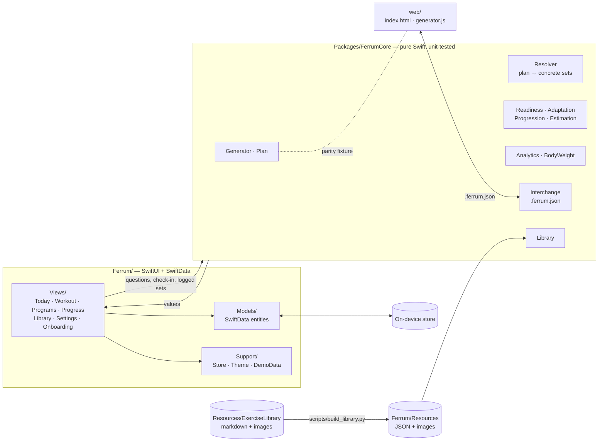

# Ferrum

A personalized strength-training coach for iOS. Generate a program around your lifts and schedule, or build your own from scratch. Ferrum adjusts the day's training from a readiness check-in and from how each set actually felt.

## Features
- **Generated programs**: powerlifting, powerbuilding, PowerCombo and full-body, built from your days per week, experience and optional muscle emphasis.
- **Custom programs**: build blocks, days and exercises yourself, or fork a generated program and edit it. Sets can be prescribed as % of 1RM, RPE/RIR targets, rep ranges with double progression, or fixed weight.
- **Readiness check-in**: sleep, energy, mood and soreness scale the day's load, sets and target RIR.
- **Performance-based adjustment**: log weight, reps and RIR; the next set is re-aimed from the estimated 1RM, and rep-range lifts progress automatically.
- **Progress**: estimated 1RM trends, hard sets per muscle, PRs.
- **Exercise library**: 143 exercises with images, muscles and cues, plus muscle and RIR guides.
- kg/lb, three themes (Forge, Chalk, Volt), all data stored on device.

## Architecture

The app is a thin SwiftUI/SwiftData layer over `FerrumCore`, a pure-Swift package that holds all training logic. A standalone web
page uses a JavaScript port of the generator and exchanges programs with the app as `.ferrum.json` files.



| Path | Purpose |
|---|---|
| `Ferrum/` | SwiftUI app: models, views, theme and resources |
| `Ferrum/Models/` | SwiftData entities |
| `Ferrum/Views/` | Screens: Today, Workout, Programs, Progress, Library, Settings, Onboarding, builders |
| `Ferrum/Support/` | `Store`, `Theme` (Forge, Chalk, Volt), `DemoData`, keyboard and haptics helpers |
| `Packages/FerrumCore/` | Pure Swift training engine with unit tests (`swift test`) |
| `Packages/FerrumCore/Sources/FerrumCore/Generator.swift`, `Plan.swift` | Program generation and the plan data model |
| `Packages/FerrumCore/Sources/FerrumCore/Resolver.swift` | Turns a prescription (% 1RM, RPE/RIR, rep range, fixed) into concrete sets |
| `Packages/FerrumCore/Sources/FerrumCore/Readiness.swift`, `Adaptation.swift`, `Progression.swift`, `Estimation.swift` | Readiness scaling, per-set adjustment, double progression, estimated 1RM |
| `Packages/FerrumCore/Sources/FerrumCore/Interchange.swift` | `.ferrum.json` import/export format |
| `Resources/ExerciseLibrary/` | Source markdown and images for the exercise library |
| `scripts/build_library.py` | Converts the library markdown to `Ferrum/Resources/*.json` and flat images |
| `web/` | Standalone program builder; `generator.js` is a port of the Swift generator |
| `project.yml` | XcodeGen spec |

### Design patterns

- **Functional core, imperative shell.** All coaching math is stateless functions over plain values in `FerrumCore`; the app
  target only stores, renders and calls it, so everything important is unit-testable with `swift test`.
- **Prescription / resolution split.** A plan stores what was *prescribed*; `Resolver` computes concrete weights and reps at
  workout time from current maxes and readiness, so a program never goes stale.
- **Cross-language parity fixture.** The Swift generator and its JS port are pinned to one `parity.json`; `swift test` fails
  when Swift drifts and `node web/parity.test.mjs` fails when JS does.
- **Versioned interchange format.** Programs move between web and app as documented JSON, defined in one file.
- **Build-time content pipeline.** The exercise library is authored as markdown and compiled to JSON by a script, not parsed at
  runtime.
- **Theme as data.** Three themes share one `Theme` abstraction instead of per-view colors.
- **Local-first.** All data is on device in SwiftData; there is no account or server.

## Build
```bash
python3 scripts/build_library.py   # only when the library markdown changes
xcodegen generate
open Ferrum.xcodeproj
```
Engine tests: `cd Packages/FerrumCore && swift test`.

## Program builder website
`web/` is a standalone page for writing or generating a program on a computer. **Generate program** asks the same questions as the app (goal, days, session length, equipment, likes/dislikes) and ends with *Customize in editor* or *Download as is*. Open `web/index.html` in a browser (no server or build step), build blocks, days and exercises, then **Download for Ferrum**. In the app: Programs → **Import from file**. The same menu exports any program as a `.ferrum.json` file. The file format is documented in `Packages/FerrumCore/Sources/FerrumCore/Interchange.swift`.

`web/generator.js` is a port of the Swift generator. Keep them in sync: `swift test` fails when Swift output drifts from `Fixtures/parity.json` (regenerate with `FERRUM_WRITE_PARITY=1 swift test --filter testGeneratorMatchesParityFixture`), then run `node web/parity.test.mjs` to confirm the JS still matches.
